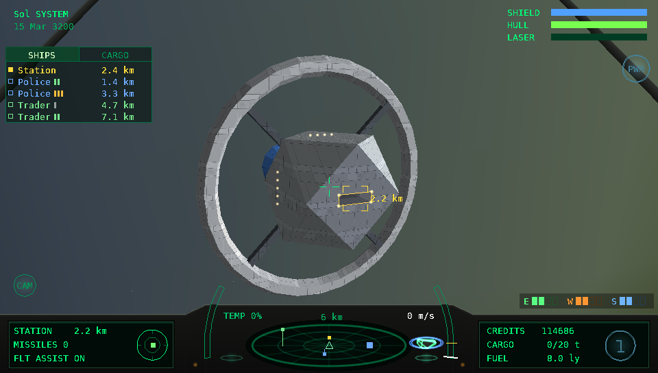
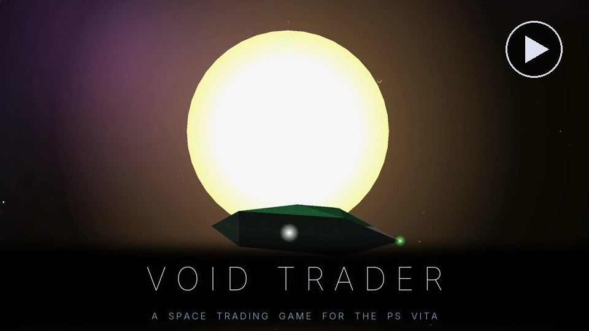
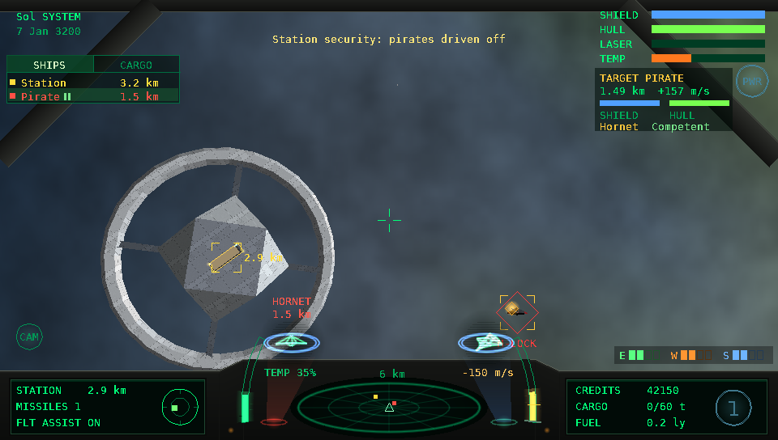
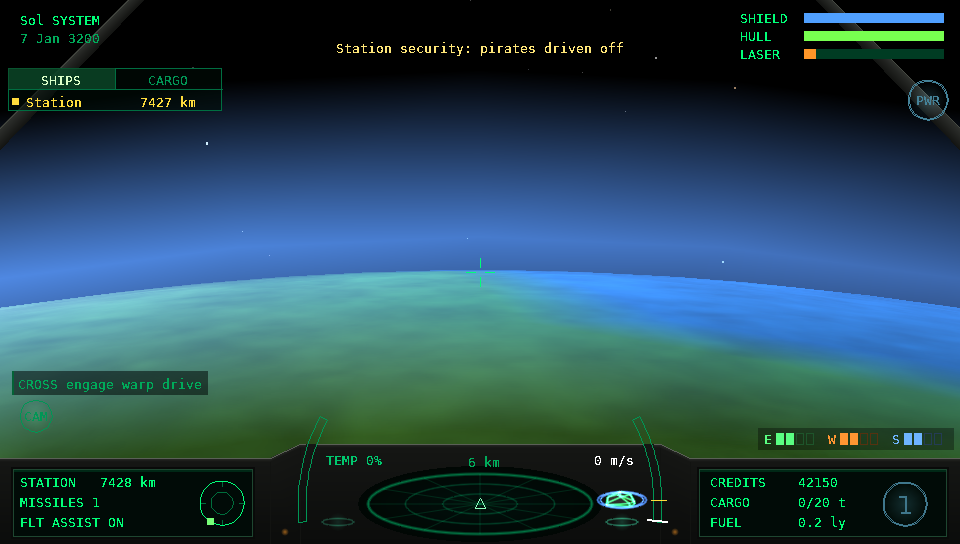
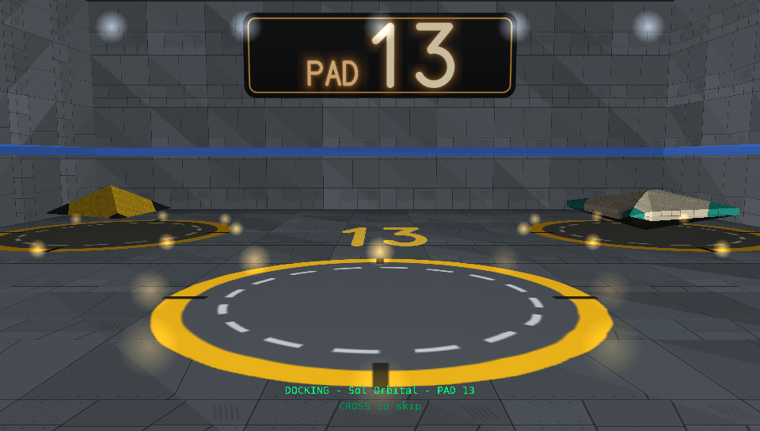
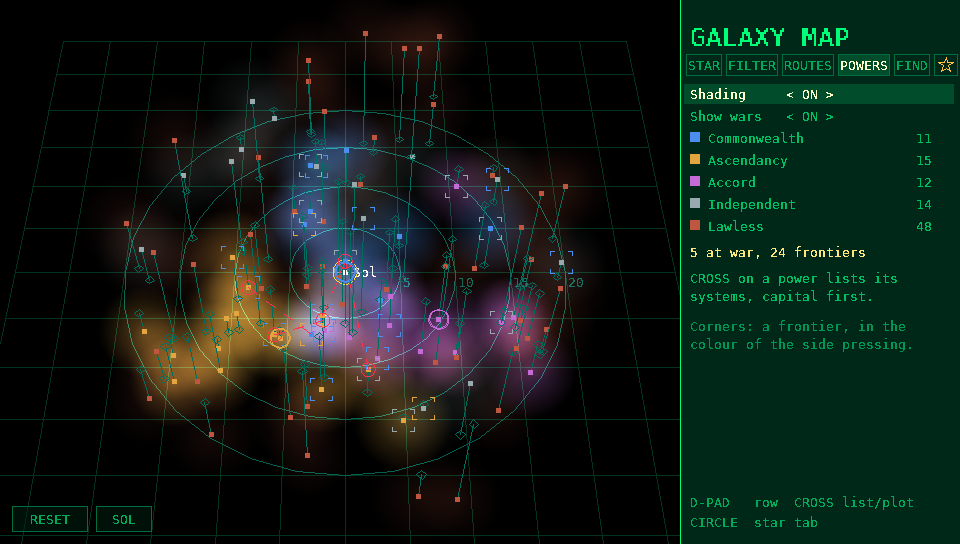
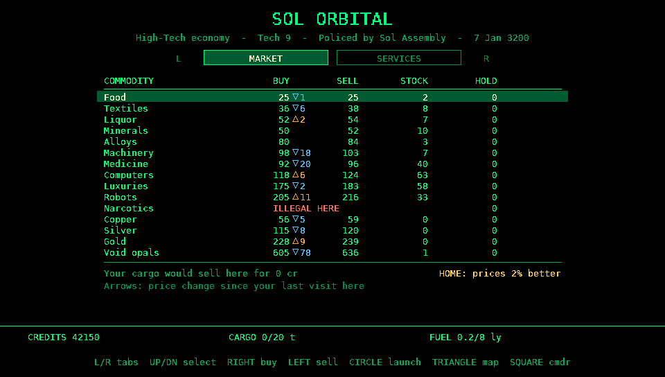
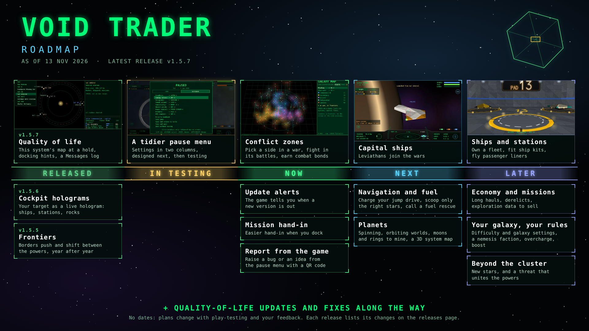

# Void Trader

A space trading game for the PS Vita: trade between real nearby stars, fight pirates, mine
asteroids, take missions for the powers and factions of a living galaxy, and dock by hand with
spinning stations. An unofficial fan homage to Elite and Frontier.

**Watch the trailer:** [Void Trader on YouTube](https://youtu.be/d2UAO6ZqYh0) (3:36): the living galaxy, a war won by missions, combat, mining and all three graphics modes.

**This repository holds releases only.** Download the game from the
[latest release](../../releases/latest), or with VitaDB Downloader on your Vita. The game's source code
is not published, and pull requests aren't accepted.

## What's in the game

- The 100 nearest real star systems, each with its own economy, planets, gas giants, asteroid belts and
  six kinds of station, and a 3D galaxy map with filters, trade routes, a star finder and favourites.
- A living galaxy: three rival powers and the independents, with factions in every system that fight
  wars, hold elections, boom, bust and expand week by week. Your missions and trade change who rules.
- Trading, a bulletin board of missions (deliveries, couriers, passengers, bounty hunts), smuggling,
  reputation with every faction, and a news feed of what's happening near you.
- Newtonian flight, docking by hand (or with a docking computer), lasers, an autocannon, missiles and
  chaff, power management, ranked pirates and police, interdictions, and mining with lasers and charges.
- 27 ships to buy, outfit, paint and name; a cockpit with holograms of your ship and your target.
- Three graphics modes: Classic wireframe, Enhanced, and Ultra with painted ships and stations, docking
  hangars and planet surfaces down to low orbit.

| | |
|---|---|
|  |  |
|  |  |

## Roadmap

What's being worked on now, what's next and what's further off. There are no dates: plans change with
play-testing and players' feedback. Each release lists its changes on the [releases page](../../releases).

## Report a bug or suggest a feature

Found a bug, or have an idea? Open an issue with one of the two forms:

- [Report a bug](../../issues/new?template=bug_report.yml): include the version and build from the title screen.
- [Suggest a feature](../../issues/new?template=feature_request.yml): check the roadmap above first.

You need a GitHub account, and issues are public. New reports are read every week. Thanks for helping.

## Installing

1. Your PS Vita needs homebrew enabled (HENkaku or Ensō) and VitaShell.
2. The game needs Sony's shader compiler, `libshacccg.suprx`, in `ur0:data/` (vitaGL compiles its
   shaders on the Vita). Most vitaGL games need it, so you may have it already; if not, extract it
   once with a tool such as ShaRKF00D. Without it the game won't start.
3. Download `voidtrader-vX.Y.Z.vpk` from the latest release.
4. Copy it to your Vita (for example over USB or FTP with VitaShell) and install it from VitaShell.
   VitaShell will warn that "this package requests extended permissions". That is expected: the
   game is built as an "unsafe" homebrew, like most vitaGL games, because it loads the shader
   compiler from `ur0:data/` in step 2. It doesn't use the extra access for anything else, and it
   only writes its own saves and settings. Press Cross (Yes) to continue.
5. Void Trader appears on the home screen. Your saves are kept in `ux0:data/` and survive updates.

The Pilot's Manual (`VoidTrader-Manual-vX.Y.Z.pdf`) is on the same release page, and the game has
a Pilot's Handbook in its pause menu.

## Made with AI

Void Trader is written with an AI assistant (Claude, by Anthropic): it is "vibecoded". Created by
Syncriel & Claude.ai.

## Licences and notices

- The game: free to download, all rights reserved - see [LICENSE](LICENSE).
- The libraries it is built with (SDL2, vitaGL, vitaShaRK, SceShaccCgExt, math-neon, taiHEN) and
  the font and star data: see [THIRD_PARTY_NOTICES.md](THIRD_PARTY_NOTICES.md) and
  [licenses/](licenses).
- Three of those libraries are under the LGPL. Each release has a **relink kit**
  (`voidtrader-relink-kit-vX.Y.Z.zip`) so you can rebuild the game against your own modified
  versions of them; its `README.md` explains how.

## Trademarks

Elite and Frontier are trademarks of Frontier Developments plc. Void Trader is not affiliated with
or endorsed by Frontier Developments. PlayStation and PS Vita are trademarks of Sony Interactive
Entertainment Inc.; Void Trader is unofficial homebrew, not affiliated with or endorsed by Sony.
